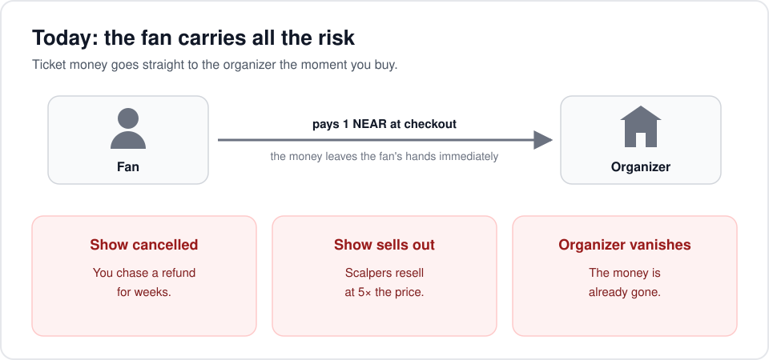
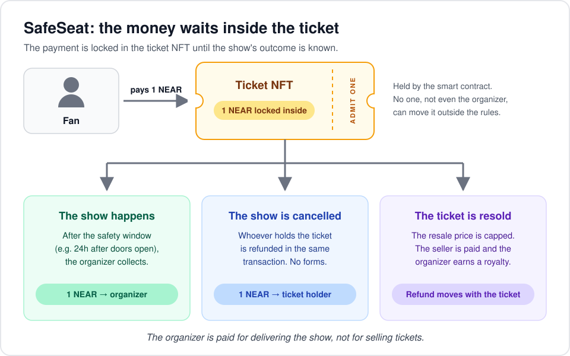
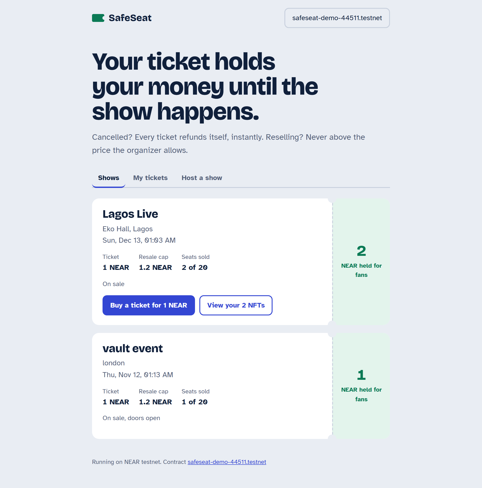
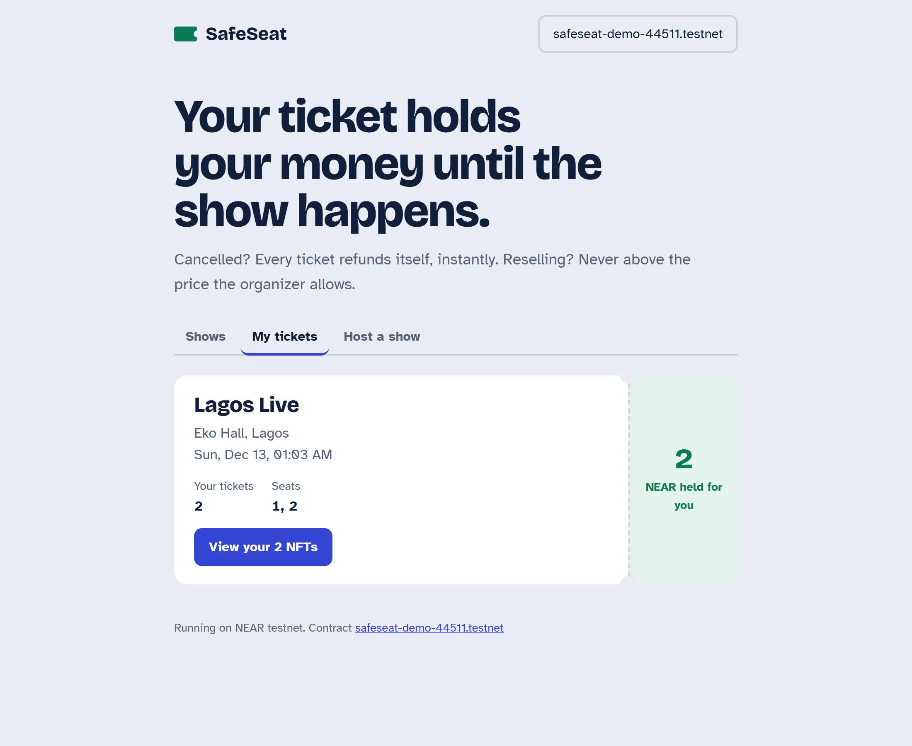
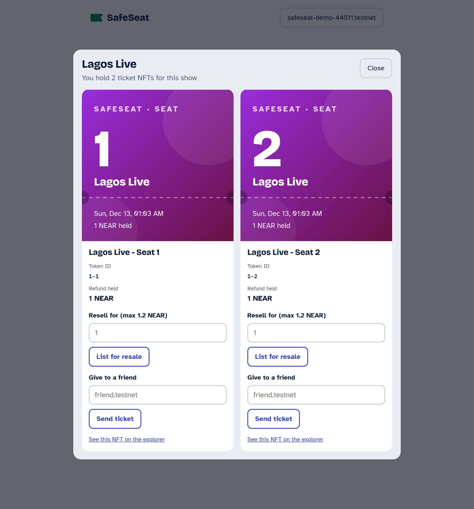
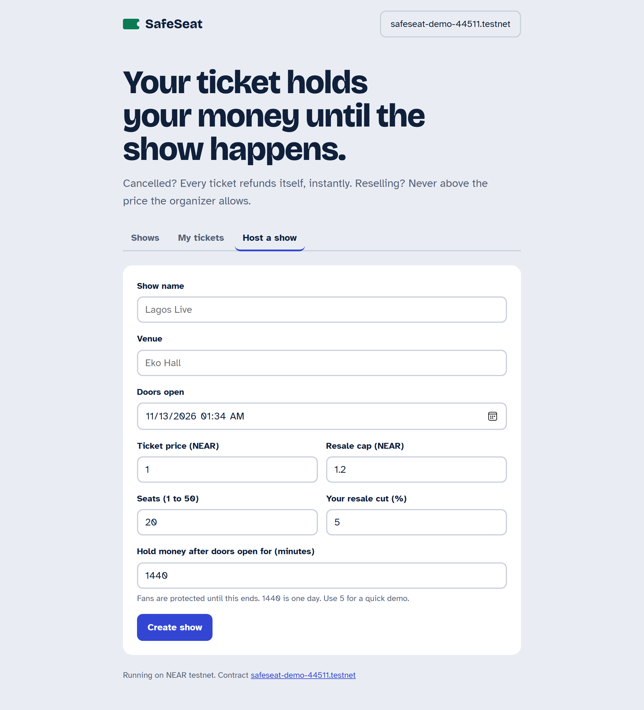
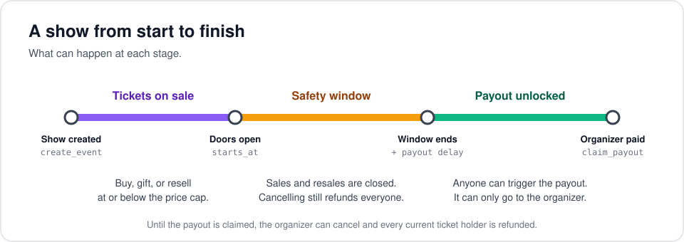
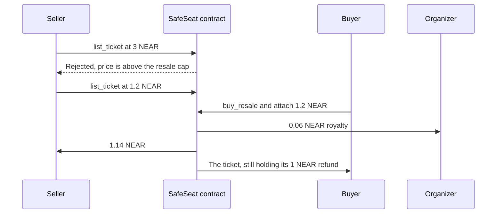

# SafeSeat

**Event tickets that hold their own refund.** Built for NEAR HACKATHON 2026.

Tracks: NFTs That Do Something, Real-World Money.

SafeSeat is a ticketing app where every ticket is an NFT that carries the money paid for it. When a fan buys a seat, the payment doesn't go to the organizer. It stays locked inside the ticket. If the show happens, the organizer collects after a short safety window. If it's cancelled, every ticket pays its holder back in a single transaction, with no claim forms. If a fan resells, the price can't go above a cap the organizer sets. The refund moves to the new owner along with the ticket.

For fans, a ticket is something you can see and own. Book two seats and you hold two NFTs, each showing its seat, its token ID and the NEAR it is holding for you. You can resell a ticket or send it to a friend from the same screen.

For organizers, it's a fair deal: you get paid for putting on the show, scalpers can't push prices past your cap, and you earn a royalty every time a ticket is resold.

**Live on NEAR testnet:** the contract is deployed at [`safeseat-demo-44511.testnet`](https://testnet.nearblocks.io/address/safeseat-demo-44511.testnet) ([deploy transaction](https://explorer.testnet.near.org/transactions/Qcp1bQhT1hcvbiDDxwD5t7rSJFNzusKeLtfA7CBpTfZ)).

## The problem

When you buy a ticket today, your money goes straight to the organizer. If the show is cancelled, you chase a refund for weeks. If it sells out, scalpers resell at 5x. Fans carry all the risk.



## How SafeSeat solves it

Your money doesn't go to the organizer when you buy. It stays locked inside your ticket, which is an NFT on NEAR, until one of three things happens:



| What happens | Where the money goes |
| --- | --- |
| The show happens | After a safety window (set by the organizer, e.g. 24h after doors open), the organizer collects. |
| The show is cancelled | Every ticket refunds whoever holds it, in the same transaction. No forms. |
| A fan resells | The price can't go above the organizer's cap. The seller is paid, the organizer gets a royalty, and the locked refund moves to the new holder with the ticket. |

The organizer is paid for delivering the show, not for selling tickets.

## A tour of the app

The screenshots below come from the running app, connected to the live testnet contract. The connected account, `safeseat-demo-44511.testnet`, bought two seats for *Lagos Live*.

### Shows

Every show on sale, laid out like a paper ticket. The stub on the right shows how much NEAR the tickets are holding for fans right now. Fans buy at face value here, and any resale listings appear under the show. If you already hold tickets for a show, a **View your NFTs** button opens them.



### My tickets

One card for each show you've booked. It shows how many tickets you hold, which seats they are, and how much of your money the tickets are holding. After a cancellation the stub reads **Refunded**; after the show it reads **Admit 2**.



### Your ticket NFTs

Click **View your NFTs** to open your tickets for that show. You get one NFT per ticket, so booking two seats shows two. Each card shows:

- **Artwork** for the show and seat. It turns grey once the show is cancelled or paid out.
- **Title and token ID**, read from the contract's NEP-171 `nft_tokens_for_owner` view.
- **Refund held**, the amount that ticket returns to you if the show is cancelled.
- **Resell** (capped by the organizer) and **Give to a friend**, both available until doors open.
- **A link to that token** on the testnet explorer.



### Host a show

Organizers set the name, venue, start time, price, resale cap, number of seats, resale royalty, and how long the money stays held after doors open. Creating the show is one transaction.



### A show from start to finish



### Reselling a ticket

Example: face value 1 NEAR, resale cap 1.2 NEAR, organizer royalty 5%.



The buyer's payment goes to the seller and the organizer right away. The original 1 NEAR stays locked in the ticket, so the new holder is protected the same way the first buyer was.

## Try it in 2 minutes (do X, see Y)

1. Open the app ([run it locally](#option-a-use-the-deployed-contract) in under a minute) and connect a testnet wallet (MyNearWallet or Meteor).
2. **Host a show**: set doors open 10 minutes from now, price 1 NEAR, cap 1.2 NEAR, and "hold money after doors open" to 5 minutes. Click **Create show**. You see it under **Shows**, holding 0 NEAR.
3. From a second account, click **Buy a ticket for 1 NEAR**. The stub now shows **1 NEAR held for fans**.
4. In **My tickets**, click **View your NFT**. Each ticket you bought shows as its own NFT (buy two and you see two). Try to resell one for 3 NEAR. The contract rejects it: *Price is above the resale cap*.
5. List it for 1.2 NEAR and buy it from a third account. The ticket moves, and so does its 1 NEAR refund.
6. As the organizer, click **Cancel show and refund everyone**. The current holder gets 1 NEAR back immediately. Check it on testnet.nearblocks.io.

(Or skip step 6, wait until the safety window ends, and click **Collect** as the organizer.)

## Run it yourself

### Option A: use the deployed contract

You only need Node 18+.

```bash
cd frontend
cp .env.example .env        # set VITE_CONTRACT_ID=safeseat-demo-44511.testnet
npm install
npm run dev                 # open http://localhost:5173
```

### Option B: deploy your own contract

You need [Rust](https://rustup.rs), [cargo-near](https://github.com/near/cargo-near), [near-cli-rs](https://github.com/near/near-cli-rs) and Node 18+.

```bash
# 1. Test the contract (14 unit tests)
cd contract
cargo test

# 2. Build the wasm
cargo near build non-reproducible-wasm

# 3. Create a free testnet account for the contract
near account create-account sponsor-by-faucet-service safeseat-YOURNAME.testnet \
  autogenerate-new-keypair save-to-keychain network-config testnet create

# 4. Deploy (no init call needed, the contract starts empty)
cargo near deploy build-non-reproducible-wasm safeseat-YOURNAME.testnet \
  without-init-call network-config testnet sign-with-keychain send

# 5. Run the app
cd ../frontend
cp .env.example .env        # set VITE_CONTRACT_ID=safeseat-YOURNAME.testnet
npm install
npm run dev                 # open http://localhost:5173
```

If a CLI command's syntax has changed, run it with `--help`; the interactive mode (`near` with no arguments) walks you through the same steps.

#### On Windows

- **Build with `--no-abi`.** On Windows, cargo-near's optional ABI step fails to link (`unresolved external symbol bls12381_...`). Skip it; the contract works the same:
  ```bash
  cargo near build non-reproducible-wasm --no-abi
  near contract deploy safeseat-YOURNAME.testnet use-file target/near/safeseat.wasm \
    without-init-call network-config testnet sign-with-keychain send
  ```
- **Installing near-cli-rs.** `npm install -g near-cli-rs` can fail under Git Bash (`tar: Cannot connect to C:`). Download `near-cli-rs-x86_64-pc-windows-msvc.tar.gz` from the [releases page](https://github.com/near/near-cli-rs/releases) and unpack it with Windows' own tar (`C:\Windows\System32\tar.exe -xzf ...`), or run the install from PowerShell.
- **`cargo test` fails to build `aws-lc-sys`.** That's a C toolchain problem with a dependency of the NEAR SDK's test mode, not the contract. Run the tests under WSL instead.

### Quick check from the terminal

```bash
C=safeseat-demo-44511.testnet
near contract call-function as-read-only $C get_events json-args '{}' network-config testnet now
```

### Host the frontend on Vercel

1. On [vercel.com](https://vercel.com), choose **Add New → Project** and import this repo.
2. Set **Root Directory** to `frontend`. Vercel detects Vite; keep the default build command (`npm run build`) and output directory (`dist`).
3. Add the environment variables `VITE_CONTRACT_ID` = `safeseat-demo-44511.testnet` (or your own contract) and `VITE_NETWORK` = `testnet`.
4. Click **Deploy**. The contract ID is baked in at build time, so redeploy after changing it.

## How it uses NEAR

- **NEP-171 NFTs**: tickets implement `nft_token`, `nft_tokens_for_owner`, `nft_transfer` and `nft_metadata`, and emit standard `nft_mint` / `nft_transfer` events, so wallets and explorers can show them.
- **Contract-held escrow**: each ticket records the refund it holds. Refunds and payouts are plain NEAR transfers made by the contract, so no one, including the organizer, can move locked money outside the rules.
- **Named accounts** (`ada.testnet`) make gifting a ticket as easy as typing a friend's name.

## Contract methods

| Method | Who | What it does |
| --- | --- | --- |
| `create_event(name, venue, starts_at_ms, payout_delay_minutes, price, max_resale, royalty_bps, capacity)` | Organizer | Creates a show. Amounts are yoctoNEAR strings. Max 50 seats, max 20% royalty. |
| `buy_ticket(event_id)` + deposit | Fan | Mints a ticket; the price is locked in it. Extra deposit is returned. |
| `list_ticket(token_id, price)` / `unlist_ticket` | Holder | Resale, capped by the organizer. |
| `buy_resale(token_id)` + deposit | Fan | Pays seller and royalty; ticket and its refund move to buyer. |
| `nft_transfer(receiver_id, token_id)` + 1 yocto | Holder | Gift; the refund goes with it. |
| `cancel_event(event_id)` | Organizer | Refunds every current holder now. |
| `claim_payout(event_id)` | Anyone | After the safety window, sends locked money to the organizer. |
| `get_events`, `get_event`, `get_tickets_for_event`, `get_tickets_for_owner`, `get_ticket` | Anyone | Views. |
| `nft_token`, `nft_tokens_for_owner`, `nft_supply_for_owner`, `nft_metadata` | Anyone | Standard NEP-171 views for wallets and explorers. |

## Known limits (honest list)

- **The safety window is time-based.** If an organizer simply doesn't show up and doesn't cancel, fans are protected only until the window ends. Next step: let ticket holders flag "the show didn't happen" during the window, which freezes the payout for review.
- **Gifts can hide side payments.** `nft_transfer` is free, so two people could agree on a price off-chain. The cap stops public scalping, not private deals.
- **Max 50 seats per show** so that cancelling refunds everyone in one transaction. Bigger shows would refund in batches.
- **The contract pays storage** for tickets from its own balance. Keep a few testnet NEAR on the contract account.
- **NFT artwork is drawn by the app.** The title, description and token ID come from the contract, but the picture is generated in the browser from the show and seat. Wallets and explorers show the token without that image. Adding a `media` field to the token metadata would fix this.
- **Refund equals face value.** If you bought a resale ticket above face value, a cancellation refunds face value; the cap limits how much that can be.

## Next steps

- Each ticket as its own NEAR sub-account (e.g. `seat-12.lagos-live.safeseat.near`) holding its money directly.
- Pay in USDC, and accept any token from any chain with NEAR Intents.
- Fan dispute flag during the safety window.

## Built with

Rust, near-sdk 5, Vite, NEAR Wallet Selector (MyNearWallet, Meteor). Code written during the hackathon.

## License

MIT
